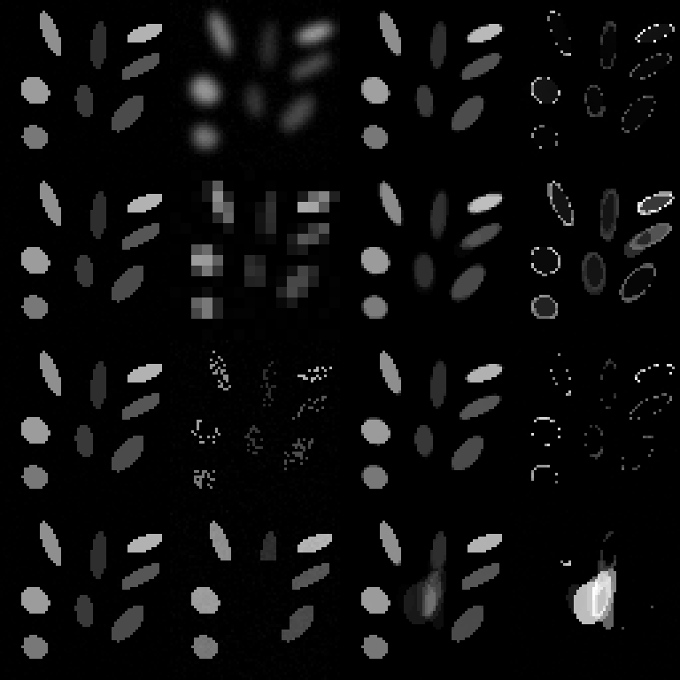

# Inverse Problems with Diffusion

## Understanding Reconstruction and Uncertainty in Imaging Inverse Problems
---



*Reconstructions from four kinds of degraded measurement of the same image, each row one degradation (top to bottom: Gaussian blur, 4x downsampling, 70% of the pixels removed at random, a hidden central box). 
Columns, left to right: ground truth, measurement, mean of 8 reconstructions, and the spread across them (bright where the reconstructions disagree).*

## Brief

Many imaging systems such as microscopes, telescopes, cameras, MRI scanners, produce blurred or incomplete measurements, and recovering the underlying image is an ill-posed problem with no unique solution. Modern methods address this by combining the measurement with a learned generative prior, which fills in what the data cannot determine. This raises a question that matters wherever such reconstructions inform a decision: when the data is insufficient, does the method admit uncertainty, or does it confidently invent plausible detail that was never there? This project investigates that question in a controlled setting. The student will be given a working reconstruction pipeline, a trained diffusion prior, and a generator for a synthetic dataset of simple geometric objects whose ground-truth parameters are known exactly. Because the true object is described by a small number of known latent parameters (i.e. centre, semi-axes, rotation, intensity), reconstruction quality can be assessed directly in terms of whether the object itself was recovered. The student will design and run experiments that progressively degrade the measurements, measure how recovery fails, and characterise whether the spread across repeated reconstructions provides an honest signal of when the result should not be trusted. The work is primarily experimental: the core deliverables are an object-fitting and evaluation framework, a systematic set of experiments, and an analysis of where the method remains reliable and where it fails.

This projects is suitable for a student comfortable with Python and interested in machine learning, scientific imaging, or the reliability of learned models. No prior background in inverse problems or diffusion models is assumed, but it is helpful.

Sources:  
\[1\] [What are Diffusion Models? | Lil'Log](https://lilianweng.github.io/posts/2021-07-11-diffusion-models/)  
\[2\]M. Bertero, P. Boccacci, and C. De MoI, *Introduction to Inverse Problems in Imaging*, 2nd edn. Boca Raton: CRC Press, 2021. doi: [10.1201/9781003032755](https://doi.org/10.1201/9781003032755).  
\[3\] G. Daras *et al.*, ‘A Survey on Diffusion Models for Inverse Problems’, Sep. 30, 2024, *arXiv*: arXiv:2410.00083. doi: [10.48550/arXiv.2410.00083](https://doi.org/10.48550/arXiv.2410.00083).

## Data download

The training images are not in the repository.

1. Download the dataset from: `<DATA_LINK>` (TODO: add link, also in `data/README.md`)
2. Unpack it so the PNG files sit directly in `data/ellipses/train/`:

```
data/
└── ellipses/
    └── train/
        ├── 000000.png
        ├── 000001.png
        └── ...
```

To generate your own data instead, see [`src/inverse_problem_with_diffusion/generator/README.md`](src/inverse_problem_with_diffusion/generator/README.md).

## Model weights download

The trained model is not in the repository. It is a Hugging Face `diffusers` pipeline made of four parts:

| File | Place it at |
|---|---|
| `model_index.json` | `checkpoints/ellipsesLQ/model_index.json` |
| `scheduler_config.json` | `checkpoints/ellipsesLQ/scheduler/scheduler_config.json` |
| `config.json` (UNet) | `checkpoints/ellipsesLQ/unet/config.json` |
| `diffusion_pytorch_model.safetensors` (weights, ~434 MB) | `checkpoints/ellipsesLQ/unet/diffusion_pytorch_model.safetensors` |

1. Download the files from: `<WEIGHTS_LINK>` (TODO: add link)
2. Create the folders and put each file in the place shown above. The result must look exactly like this:

```
checkpoints/
└── ellipsesLQ/
    ├── model_index.json
    ├── scheduler/
    │   └── scheduler_config.json
    └── unet/
        ├── config.json
        └── diffusion_pytorch_model.safetensors
```

3. Check that it loads:

```bash
uv run python -c "from diffusers import DDPMPipeline; DDPMPipeline.from_pretrained('checkpoints/ellipsesLQ'); print('ok')"
```

More details on the checkpoint are in [`checkpoints/README.md`](checkpoints/README.md).

## Train your own model

Instead of downloading the weights, you can train a diffusion model on your own data.

> [!WARNING]
> Training the default model (~114M parameters) needs a GPU with enough memory and takes a long time. Without a GPU, or on a laptop, a full run is impractical. If memory runs out, reduce `train_batch_size` or use a smaller model via `block_out_channels`.

1. **Get images.** Download the data (see above) or generate your own with the [ellipse generator](src/inverse_problem_with_diffusion/generator/README.md). Any folder of `.png` files works, and images are resized to `image_size` if they differ. To use a different data format, replace the `Dataset` in `src/inverse_problem_with_diffusion/data.py`. It must return a `(C, H, W)` tensor scaled to `[-1, 1]`.
2. **Edit the config** `configs/ddpm_ellipses.toml`:
   - `data_dir`: the folder of images.
   - `image_size` and `in_channels`: must match your data (the default is 64 x 64 grayscale).
   - `output_dir`: where the model is saved, e.g. `checkpoints/my_model`.
   - `num_epochs`, `train_batch_size`, `learning_rate`, and the model size via `block_out_channels`.
3. **Train:**

```bash
uv run python -m inverse_problem_with_diffusion.ddpm --config configs/ddpm_ellipses.toml
```

`--num_epochs`, `--output_dir` and `--seed` override the config. The default model is the same ~114M-parameter UNet as `ellipsesLQ`, so use a GPU for a full run. For a quick test, set `block_out_channels = [32, 32, 32, 32, 32, 32]`.

The pipeline is saved to `output_dir` every `save_model_epochs` epochs and after the last one, in the layout described in [`checkpoints/README.md`](checkpoints/README.md). Loss and sample images are logged to TensorBoard:

```bash
uv run tensorboard --logdir checkpoints/my_model/logs
```

## Run a reconstruction

`reconstruct.py` takes ground-truth images, degrades them into measurements `y = A(x) + noise`, and draws several reconstructions from the diffusion prior with [DPS](src/inverse_problem_with_diffusion/dps.py). The spread across the reconstructions is the uncertainty signal.

```bash
uv run python -m inverse_problem_with_diffusion.reconstruct --config configs/reconstruct.toml
```

Set the experiment in `configs/reconstruct.toml`:

| Setting | Meaning |
|---|---|
| `checkpoint` | the prior, e.g. `checkpoints/ellipsesLQ` |
| `image_dir`, `num_images` or `images` | which ground-truth images to use |
| `operator`, `operator_params` | the degradation (see `operators.py`): `gaussian_blur {sigma}`, `downsample {factor}`, `random_mask {keep_fraction}`, `box_mask {side_fraction}`. A larger blur, factor or hidden area is harder. |
| `noise_sigma` | standard deviation of the noise added to the measurement |
| `num_samples` | reconstructions per measurement |
| `scheduler`, `num_inference_steps`, `guidance_scale`, `eta` | DPS sampler settings |
| `output_dir`, `seed`, `device` | where results go, reproducibility, `auto` / `cuda` / `mps` / `cpu` |

For each image, `output_dir/<image>/` gets `ground_truth.png`, `measurement.png`, one `recon_NNN.png` per sample, a `summary.png` (ground truth, measurement, mean, spread, samples) and `tensors.pt` with the raw `x_true`, `y` and `recons` in [0, 1] for evaluation. `config.json` records the settings used.
