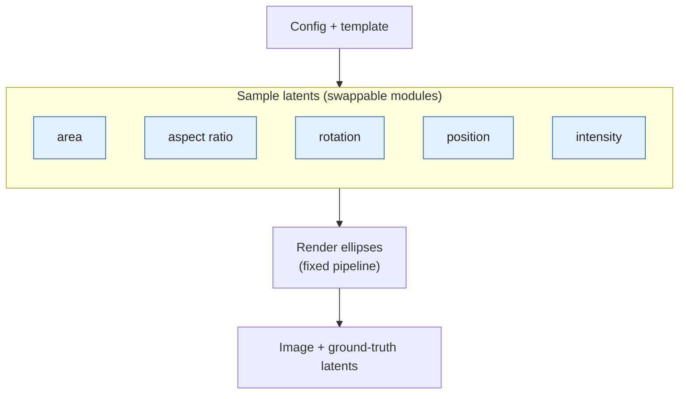

# Ellipse generator

This generator produces synthetic grayscale images of non-overlapping ellipses on a dark, lightly noisy background, together with the exact latent variables that produced them. Each ellipse is described by a small set of latents: its area fraction, aspect ratio, rotation, centre position and intensity. By default these are drawn independently from the ranges given in a TOML config. An image is built by repeatedly sampling an ellipse, rasterising it with sub-pixel anti-aliasing, and rejecting it if it would touch an ellipse already placed (a configurable "moat"), until the requested number of ellipses fits. Every image is seeded by the dataset seed and its own index, so a dataset is fully reproducible. The latents of every ellipse are saved to `metadata.json` next to the PNGs. Because the data-generating process is explicit, it can be changed in a controlled way. Modules (templates) override individual steps, for example making the aspect ratio depend on area or position, or making intensity depend on shape, which introduces known dependencies between latents and lets you study how a model copes with them.

The system is modular because the default generator is a class in which each step is a small method, and a template is a subclass that overrides only the steps it wants to change; everything else is inherited, so the rest of the pipeline (placement, rasterisation, moat, noise, saving) stays identical across datasets. Two examples show the range. The `oscillatory_aspect_area` template overrides a single method, `_sample_Ar`, so that an ellipse's aspect ratio becomes a sinusoidal function of its area. Position, rotation and everything else are still drawn as in the default, so the only change in the data is that one dependency. The `position_modulated_aspect` template changes the *order* of sampling instead. It draws the vertical position first and then derives the aspect ratio from area and position, so the aspect ratio drifts with an ellipse's height in the image. It can also be paired with an intensity rule from the covariation library, set in the config as `intensity = "eccentricity"`, so that brightness follows the resulting shape. A new dataset variant is therefore a short subclass plus a config file, not a new generator.

> **Key idea:** `core.py` defines the data-generating process as a set of swappable modules (sample the area, the aspect ratio, the rotation, the position, the intensity). Swapping one or more of them produces data with a different underlying latent structure, while the rest of the pipeline and the saved ground-truth latents stay the same.



Blue boxes are the swappable modules. Replacing one (for example making aspect ratio depend on area) changes how the latents relate to each other; the fixed rendering pipeline and the saved ground truth stay the same.

```
uv run python -m inverse_problem_with_diffusion.generator.generate_dataset \
    --config configs/ellipse_baseline_train.toml [--out DIR] [--n-samples N] [--workers K]
```

or from Python: `build_generator("configs/....toml").save_images()`.
Output is `NNNNNN.png` plus `metadata.json` (all latents of every ellipse) in `[paths] name`.
Every image is seeded by `(seed, index)`, so output is reproducible and independent of `--workers`.

## Layout

| Path | Role |
|---|---|
| `dependencies/core.py` | `EllipseDatasetGenerator`: the default generator, all latents independent |
| `dependencies/covariations.py` | `CovariationPatterns`: library of latent couplings and intensity functions |
| `dependencies/specs.py` | dataclasses + `load_config` for the TOML |
| `templates/` | subclasses that override parts of the core; registered in `templates/__init__.py` |
| `generate_dataset.py` | CLI and `build_generator` |
| `configs/*.toml` (repo root) | one file = one dataset |

## Config

`[paths] name`, `[dataset] n_samples, seed`, `[canvas]`, `[sampler]`, `[render]`, plus optional

```toml
[generator]
template = "default"      # key of templates.TEMPLATES
n_ellipses = 8
intensity = "eccentricity" # optional: CovariationPatterns.<name>_intensity, else uniform random
```

Unknown keys raise an error.

## Writing a module

Subclass the core and override only what differs.

**Change one latent**: override a sampler. It receives the latents drawn so far as keywords.

```python
class MyGenerator(EllipseDatasetGenerator):
    def _sample_Ar(self, rng, Af=None, **latents):
        return np.clip(1.5 + 3 * Af, self.sampler.Ar_lo, self.sampler.Ar_hi)
```

**Change the order** (e.g. position first, shape depends on it): override `sample_geometry` and
finish with `self._place(rng, af, ar, theta, cx=cx)`. `_place` draws whatever of `cx`/`cy` you did not
fix, and returns `None` if the ellipse does not fit, so retry in a loop.
See `templates/position_modulated_aspect.py`.

**Change intensity**: add a `<name>_intensity(**latents, W, H, rng, **kwargs)` function to
`CovariationPatterns` and set `intensity = "<name>"`, or override `_sample_intensity(self, rng, g)`.

Always draw randomness from the `rng` you are given, never from `np.random`.
Register the class in `templates/__init__.py` and select it with `template = "..."`.
